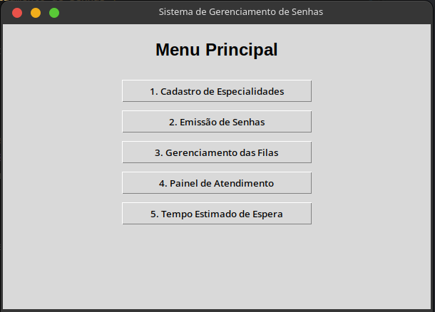
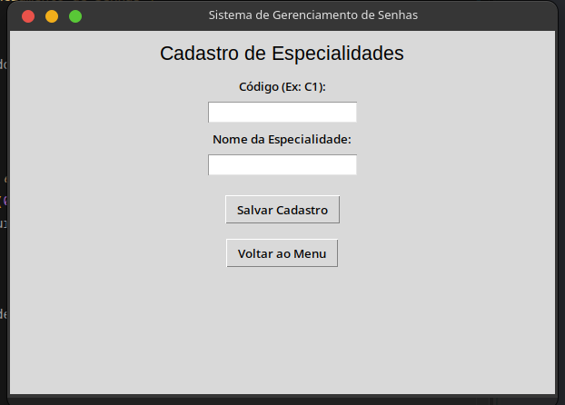
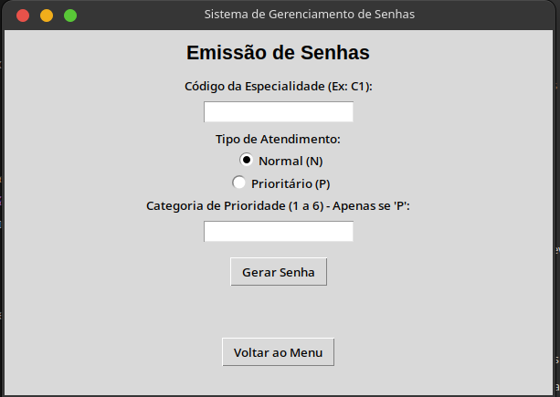
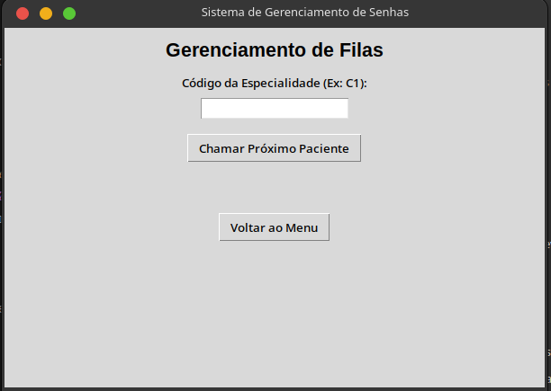
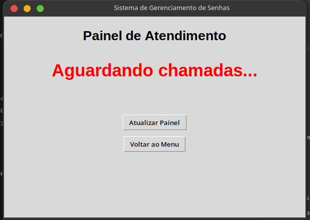
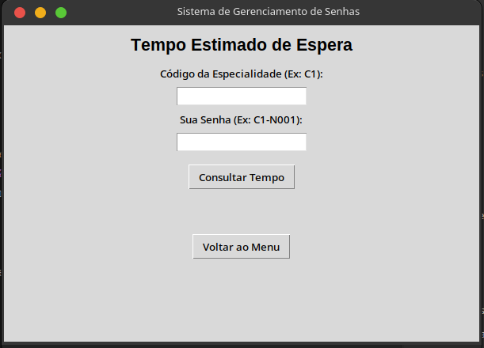

# Sistema de Gerenciamento de Senhas para Clínica Médica

Trabalho prático da disciplina **Estrutura de Dados II**, sob orientação da Profa. Karla Sartin.

## Integrantes

* Danilo Tavares Lima - 43440924

## Vídeo demonstrativo

Link do vídeo: **[PENDENTE]**

## Situação-problema

Uma clínica médica atende em diferentes especialidades, como Clínica Geral, Pediatria, Ginecologia, Cardiologia e Psiquiatria. A organização das filas é feita manualmente, o que dificulta o controle da ordem de chegada, a identificação dos pacientes prioritários e o acompanhamento do tempo de espera.

## Objetivo do sistema

Desenvolver uma aplicação funcional em Python, com interface gráfica em Tkinter, que simule o fluxo de uma clínica desde a emissão das senhas até a chamada para atendimento. O sistema organiza os atendimentos por especialidade, respeita as prioridades definidas e exibe as informações em tempo real.

## Tecnologias e bibliotecas utilizadas

| Item | Uso |
| --- | --- |
| Python 3 | Linguagem principal |
| Tkinter | Interface gráfica |
| collections.deque | Implementação das filas FIFO |
| heapq | Implementação da fila de prioridade |
| Git e GitHub | Controle de versões |

Não há dependências externas. Todas as bibliotecas fazem parte da biblioteca padrão do Python.

## Estruturas de dados implementadas

### Fila FIFO (First In, First Out)

Utilizada para organizar as senhas normais e para preservar a ordem de chegada entre pacientes da mesma categoria de prioridade.

* **Inserção:** feita ao emitir uma nova senha.
* **Remoção:** feita ao chamar o próximo paciente.
* **Consulta:** usada para listar as senhas pendentes e a ordem de atendimento.

### Fila de prioridade

Utilizada para selecionar os pacientes prioritários de acordo com a classificação didática do exercício. Cada senha prioritária entra na estrutura com a chave `(ordem da categoria, número sequencial de chegada)`. Assim, a categoria define quem é chamado primeiro e, em caso de empate, vale a ordem de chegada.

| Ordem | Categoria |
| --- | --- |
| 1 | Pacientes com 80 anos ou mais |
| 2 | Pacientes idosos de 60 a 79 anos |
| 3 | Pessoas com deficiência (PCD) |
| 4 | Gestantes |
| 5 | Pessoas com obesidade |
| 6 | Pessoas acompanhadas de criança de colo |

### Regra de chamada

1. Se houver senhas prioritárias aguardando na especialidade, a de maior prioridade é chamada.
2. Se não houver prioritárias, a primeira senha normal da fila FIFO é chamada.
3. Se não houver nenhum paciente, o sistema informa que a fila está vazia.

Cada especialidade possui suas próprias estruturas e sua própria numeração sequencial, de forma independente.

## Formato das senhas

A senha é composta por `identificador da especialidade` + `tipo de atendimento` + `número sequencial`.

| Senha | Significado |
| --- | --- |
| C1-N001 | Clínica Geral, atendimento normal |
| C1-P002 | Clínica Geral, atendimento prioritário |
| C2-N001 | Pediatria, atendimento normal |
| C3-P001 | Cardiologia, atendimento prioritário |

## Cálculo do tempo estimado de espera

O tempo médio de atendimento considerado é de 30 minutos por paciente.

```
Tempo estimado = Quantidade de pacientes à frente × 30 minutos
```

A quantidade de pacientes à frente é calculada a partir da ordem prevista de atendimento da especialidade, considerando as prioridades. Exemplo: com quatro pacientes à frente, o tempo estimado é 4 × 30 = 120 minutos. O valor é atualizado sempre que uma senha é emitida ou chamada.

## Funcionalidades disponíveis

* **Menu principal:** acesso a todas as telas do sistema.
* **Cadastro de especialidades:** permite cadastrar até três especialidades, sem duplicidade.
* **Emissão de senhas:** escolha da especialidade, do tipo de atendimento e da categoria de prioridade, com exibição da senha gerada.
* **Gerenciamento das filas:** exibe as senhas aguardando por especialidade e permite chamar o próximo paciente.
* **Painel de atendimento:** mostra a senha chamada, a especialidade, o tipo de atendimento e a quantidade de pacientes aguardando.
* **Tempo estimado de espera:** consulta por especialidade e por senha.
* **Validação de entradas:** mensagens claras para operações inválidas, como cadastrar uma quarta especialidade ou chamar uma fila vazia.

## Estrutura do projeto

```
clinica-medica/
├── docs/
│   └── images/                  Capturas de tela usadas neste README
├── interface/                   Camada de interface gráfica (Tkinter)
│   ├── cadastro_especialidades.py
│   ├── emissao_senhas.py
│   ├── gerenciador_filas.py
│   ├── menu_principal.py
│   ├── painel_atendimento.py
│   └── tempo_espera.py
├── logica/                      Camada de lógica (sem dependência de Tkinter)
│   ├── gerenciador.py
│   └── modelos.py
├── constants.py                 Constantes do sistema
├── main.py                      Ponto de entrada
└── README.md
```

A lógica de gerenciamento das filas fica separada da interface gráfica: o pacote `logica` não depende do Tkinter, e o pacote `interface` apenas consome os serviços do gerenciador.

## Como executar

**Pré-requisitos:** Python 3.8 ou superior com Tkinter instalado. No Windows e no macOS, o Tkinter já acompanha o instalador oficial do Python. No Linux (Debian/Ubuntu), instale com:

```bash
sudo apt install python3-tk
```

**Passos:**

```bash
git clone <URL-DO-REPOSITORIO>
cd clinica-medica
python main.py
```

## Imagens da interface gráfica

### Menu principal


### Cadastro de especialidades


### Emissão de senhas


### Gerenciamento das filas


### Painel de atendimento


### Tempo estimado de espera


## Testes realizados

Os testes abaixo foram executados e demonstrados no vídeo.

| Teste | Descrição | Resultado esperado |
| --- | --- | --- |
| 1. Cadastro | Cadastrar três especialidades e tentar cadastrar uma quarta | A quarta é recusada com mensagem de erro |
| 2. Emissão | Gerar ao menos cinco senhas normais e quatro prioritárias entre as especialidades | Senhas geradas com numeração independente por especialidade |
| 3. Prioridades | Chamar uma senha prioritária emitida depois de uma normal | A prioritária é chamada primeiro |
| 4. FIFO | Emitir duas senhas da mesma categoria prioritária | A primeira emitida é a primeira chamada |
| 5. Tempo estimado | Consultar uma senha com pacientes à frente | Tempo igual a pacientes à frente × 30 minutos |
| 6. Fila vazia | Chamar um paciente de uma fila vazia | Mensagem informando que não há pacientes aguardando |

## Observação

A classificação de prioridades adotada é uma regra didática do exercício. Em uma aplicação real, a política de atendimento deve seguir a legislação vigente e os protocolos da instituição.